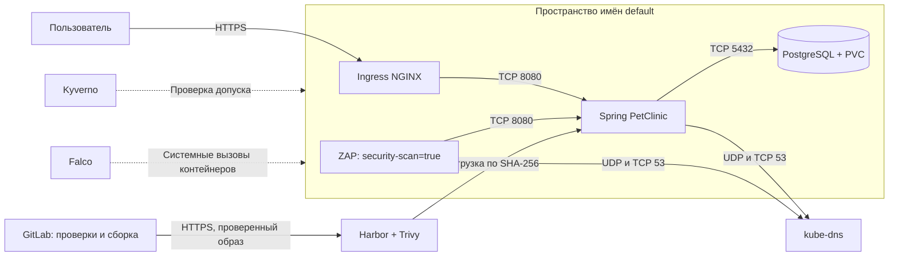

# Защита Spring PetClinic

## Назначение и границы системы

Spring PetClinic хранит сведения о владельцах животных, питомцах, посещениях и ветеринарах. Приложение работает с PostgreSQL. Развёртывание включает Ingress, приложение и базу данных. GitLab выполняет проверки исходного кода и образа перед публикацией в Harbor.

Учебный стенд состоит из отдельной ВМ сборки и одноузлового Kubernetes-кластера; анализ кода выполняется в учебном SonarQube. Доступ администратора выполняется через SSH. Порты базы данных не публикуются. Для прикладных ресурсов используется пространство имён `default`, как предусмотрено заданием; системные средства защиты и аудит размещены отдельно.

Границы доверия проходят между пользователем и Ingress, приложением и базой данных, исполнителем GitLab и реестром образов, а также контейнерами и узлом Kubernetes. Сетевой доступ не заменяет проверку полномочий пользователя.

## Пять основных угроз

| № | Категория STRIDE и компонент | Сценарий и последствия | Защита и способ проверки |
|---|---|---|---|
| 1 | Повышение привилегий — контейнер приложения | Эксплуатация ошибки Java-приложения даёт доступ к процессам и файлам контейнера; запуск от root увеличивает последствия и возможности атаки на узел. | UID 10001, `runAsNonRoot`, запрет повышения привилегий, удаление всех дополнительных полномочий, профиль seccomp, корневая ФС только для чтения. Kyverno запрещает запуск контейнеров без этих настроек. Проверка: отклонение небезопасного Pod и отказ записи в `/app`. |
| 2 | Подмена и раскрытие данных — Git, CI и Secrets | Опубликованный пароль или токен позволяет читать базу, подменять образ или запускать чужой код от имени исполнителя. | Gitleaks проверяет всю историю. Пароли генерируются отдельно; `.env` исключён из Git. В GitLab используются защищённые переменные, в Kubernetes — Secrets. У Harbor отдельные технические учётные записи для публикации и чтения. При реальной утечке сначала отзывается секрет, затем очищается история и повторяется проверка. |
| 3 | Изменение и раскрытие данных — PostgreSQL | Захваченный соседний контейнер подключается к БД, получает сведения о клиентах или изменяет записи. | PostgreSQL доступен только по ClusterIP. Сетевая политика допускает TCP 5432 только от PetClinic; весь остальной обмен закрыт. Проверка: PetClinic читает данные, сканер не может подключиться к БД, посторонний Pod не может обратиться к приложению. |
| 4 | Подмена и изменение кода — зависимости и образ | Уязвимая библиотека либо изменившийся тег образа переносит известную уязвимость в рабочее окружение. | Зафиксированы исходная версия и базовые образы. Maven и JDK отсутствуют в конечном образе. SonarQube, Hadolint, Trivy и Dockle выполняются до публикации. HIGH/CRITICAL блокируют сборку. Harbor повторно сканирует образ; Deployment использует SHA-256. |
| 5 | Отказ в обслуживании и изменение файлов — работающий сервис | Массовые запросы исчерпывают память, процессор или место; после эксплуатации атакующий пытается сохранить исполняемый файл либо изменить приложение. | Ограничения ресурсов, проверка готовности, ограничение частоты запросов Ingress, временные тома ограниченного размера. Falco фиксирует попытки открыть для записи файл вне `/tmp`, включая неудачные. ZAP проверяет HTTP-интерфейс; kube-bench проверяет конфигурацию узла. |

## Защита обработки форм

SonarQube выявил прямую привязку параметров HTTP-запросов к сущностям базы данных (`java:S4684`). Контроллеры переведены на отдельные классы форм `OwnerForm`, `PetForm` и `VisitForm`. Разрешённые поля перечислены явно; идентификаторы и связанные объекты загружаются сервером. Проверки отправляют подменённые `id`, `pets[0].name`, `type.id` и поля владельца через формы питомца и посещения и проверяют, что защищённые значения не изменились.

## Решения по сети и доступу

Запрещены все входящие и исходящие соединения в `default`, кроме явно разрешённых. PostgreSQL не имеет исходящего сетевого доступа. PetClinic обращается только к PostgreSQL и DNS. ZAP обращается только к PetClinic и DNS. TCP 53 разрешён вместе с UDP 53, чтобы корректно обрабатывать крупные DNS-ответы и повторные запросы.

Метка `security-scan=true` предоставляется только заданиям проверки. Назначать эту метку и создавать Pod должны операторы с соответствующими правами: сама метка не является механизмом авторизации. Приложение и задания проверки не получают токен учётной записи Kubernetes.

Узел использует доверенный сертификат локального Harbor; проверка TLS не отключается. Публикация и загрузка образов используют разные учётные записи с ограниченными правами. Временный SSH-туннель связывает учебные сети и не открывает реестр в интернет.

## Исключение для аудита узла

kube-bench работает в `security-audit`, поскольку ему нужны видимость процессов узла и чтение системной конфигурации. Доступные каталоги узла подключены только для чтения. Задание ограничено по времени, не получает токен Kubernetes и не имеет сетевого доступа. Политика Kyverno для прикладного пространства имён при этом остаётся включённой. Такой доступ нельзя выдавать приложению или обычным заданиям сборки.

## Обработка результатов в жизненном цикле разработки

1. Изменение проходит проверку коллегой. Проверяются зависимости, Dockerfile, манифесты и необходимость новых секретов и сетевых соединений.
2. GitLab параллельно запускает поиск секретов, анализ Dockerfile, проверку зависимостей и SonarQube. Отчёты сохраняются и при ошибке задания.
3. Утечка секрета, HIGH/CRITICAL или провал порога качества останавливают выпуск. Ответственный разработчик проверяет применимость находки и исправляет причину. Ложное срабатывание допускается исключать только с записанным обоснованием, сроком и согласованием владельца безопасности.
4. После сборки выполняются Dockle и повторное сканирование конечного образа. Только прошедший проверки образ публикуется в Harbor.
5. Перед обновлением Deployment проверяются SHA-256, результат сканирования Harbor и манифесты. Kyverno проверяет создаваемые контейнеры, затем выполняются проверки доступности и сетевой изоляции.
6. После развёртывания запускаются ZAP и проверка Falco. Находка закрывается после повторной проверки на исправленной версии. В отчёте сохраняются версия кода, digest, время проверки и результат.
7. Базы уязвимостей обновляются перед проверками. Повторное сканирование выполняется регулярно и после публикации критических исправлений. Отслеживаются время исправления, просроченные задачи и число повторно открытых находок.

## Границы готовности

Это учебное одноузловое развёртывание. Отказ узла останавливает сервис; PVC обеспечивает сохранность данных при пересоздании Pod, но не заменяет резервное копирование. Для эксплуатации с реальными персональными данными необходимы корпоративная аутентификация и разграничение доступа, резервное копирование с проверкой восстановления, централизованное хранение событий и отказоустойчивость инфраструктуры. Штатный PetClinic не реализует роли сотрудников и предназначен для демонстрации работы Spring.
